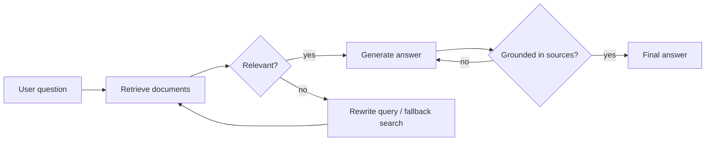

<!-- ============ BANNER ============ -->

 

 

<!-- ============ ABOUT ============ -->
## 👋 About me

<table>
<tr>
<td width="230" align="center">
  
   <b>Shaurya Agrawal</b>
   Final-year college student
</td>
<td>

I build **LLM-powered applications** and the **pipelines** that make them reproducible.

- 🔭 Building: `TODO: your current project, one line`
- 🌱 Learning: `TODO: one specific thing, e.g. RAG evaluation, LangGraph`
- 🎯 Looking for: **GenAI / ML engineering roles and internships**
- 💡 What I care about: RAG that *checks its own answers* instead of hallucinating confidently
- 📍 Based in: `TODO: city, country`

</td>
</tr>
</table>

<!-- ============ SKILLS ============ -->
## 🛠️ Skills

  

| Area | What I work with |
|---|---|
| 🤖 **GenAI** | RAG, self-correcting retrieval, LangChain, Hugging Face, transformer architecture |
| ⚙️ **MLOps** | End-to-end pipelines, data and model versioning with DVC |
| 🐍 **Core** | Python, Jupyter, Git/GitHub |

> Only list a tool here if you can explain it in an interview. Add more once you've shipped something with it.

<!-- ============ PROJECTS ============ -->
## 🚀 Featured projects

 

### 🧠 Self-Correcting RAG

`TODO: 2-3 sentences. What problem it solves, how the correction loop works, one result with a number.`

> ⚠️ This diagram shows a generic self-correcting RAG flow. **Edit it to match what your project actually does**, or delete it. A diagram that doesn't match your code is worse than none.

<!-- ============ STATS ============ -->
## 📊 GitHub stats

<!-- ============ CONTACT ============ -->
## 📫 Let's connect

Open to **GenAI / ML internships and entry-level roles**. Email is the fastest way to reach me.

