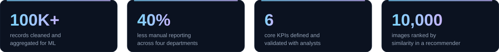
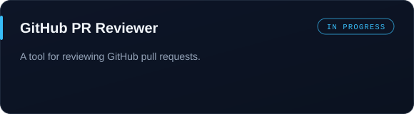
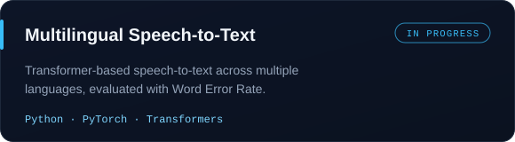
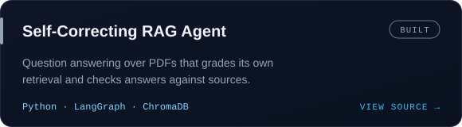
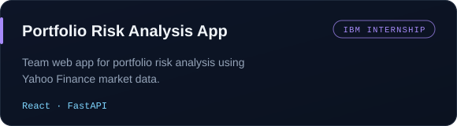
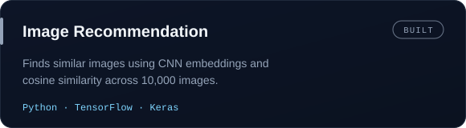
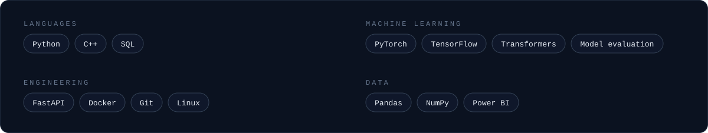

  <a href="https://www.linkedin.com/in/shaurya-agrawal28">LinkedIn</a> &nbsp;·&nbsp;
  <a href="mailto:shauryaagrawal756@gmail.com">Email</a>
  <!-- TODO: add " &nbsp;·&nbsp; <a href="YOUR-RESUME-LINK">Resume</a>" once you have a public resume link -->

## About

I'm a Computer Science undergraduate (B.Tech, 2027) at UPES, Dehradun. I build software across machine learning, data and backend engineering, and I like taking an idea from a rough prototype to something that actually runs.

Open to software, ML and GenAI engineering internships and 2027 graduate roles.

## Projects

  
  
  
  
  

<!-- TODO: add a link to each project's repo by wrapping its  in <a href="REPO-URL">...</a>, as done for the RAG card. Fill in the PR Reviewer description in assets/card-pr-reviewer.svg. -->

## Experience

**AI/ML Intern, Dataview Analytics** &nbsp;Remote · Apr – Jun 2025

- Built a Python and SQL preprocessing workflow that cleaned, standardised and aggregated 100,000+ records from multiple regional sources into ML-ready datasets for weekly reporting.
- Created Excel reporting templates for four departments, cutting manual reporting effort by 40%.
- Built Power BI dashboards for revenue, customer segmentation and time-based KPIs, and defined and validated six core KPIs with analysts and stakeholders.

**IBM Summer Internship Program** &nbsp;Jun – Jul 2026

Two-month, project-based internship. Worked in a team on a web-based portfolio risk analysis application (React, FastAPI) using Yahoo Finance data.
<!-- TODO: add one sentence on what YOU personally built. -->

## Education

**B.Tech, Computer Science and Engineering** · University of Petroleum and Energy Studies, Dehradun · 2023 – 2027

## Toolkit

## Contact

The fastest way to reach me is [email](mailto:shauryaagrawal756@gmail.com). I'm also on [LinkedIn](https://www.linkedin.com/in/shaurya-agrawal28).
